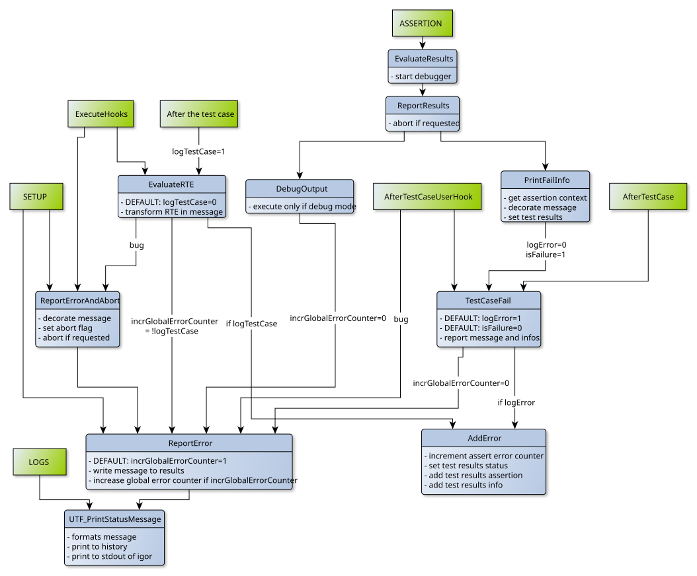

.. vim: set et sts=3 sw=3 tw=79:

.. _developer:

Developer Documentation
=======================

Some diagrams are generated with yEd. Due to license restrictions we have to
include the project file and the generated svg in this repository.

Installation steps for running the tests
----------------------------------------

Create a link from ``tests`` in the ``User Procedures`` subfolder.

.. _Coverage:

Current Test Coverage
---------------------

`Coverage Test Report <report/>`_

.. attention::
   The current coverage test report does only include the results of some tests
   but not all. We intent to migrate existing tests to generate a coverage
   report but it is very unlikely to reach 100% coverage.

.. _GlobalVariables:

Global Variables
----------------

These variables are stored in ``root:Packages:igortest:``. The list covers the
ones which matter when reading the framework and is not exhaustive; the
procedure files are the authoritative source.

Nothing in that folder exists before a test run: every object is created by the
first code path that needs it and is kept afterwards. The folder therefore holds
everything belonging to the features used by the test runs of the current
session. An entry whose description names the feature that creates it appears
only once that feature has been used; the others are created by any test run,
because the run setup clears them before building them again.

#. Waves

   * ``TestRunData``, ``/T``, 2D
      * Contains the setup data for each test case
   * ``TestRunResult``, ``/T``, 2D
      * Contains the test results for the test run
   * ``TestSuiteResult``, ``/T``, 2D
      * Contains the test results for the test suites
   * ``TestCaseResult``, ``/T``, 2D
      * Contains the test results for the test cases
   * ``TestAssertionResult``, ``/T``, 2D
      * Contains the assertions for the test cases
   * ``TestInfoResult``, ``/T``, 2D
      * Contains the infos for the assertions
   * ``InfoMsg``, ``/T``, 1D
      * Contains the stored information that provide more context for the next
        assertion.
   * ``FailedProcWave``, ``/T``, 1D
      * used for summary at the end of the test run
   * ``DataGeneratorWaves``, ``/WAVE``, 1D
      * used for the multi data test cases
   * ``DataGeneratorRefs``, ``/T``, 1D
      * full function names at the same positions as ``DataGeneratorWaves``
   * ``FunctionTagWaves``, ``/WAVE``, 1D
      * contains function tags
   * ``FunctionTagRefs``, ``/T``, 1D
      * full function names at the same positions as ``FunctionTagWaves``
   * ``MMDataState``, ``/WAVE``, 1D
      * state waves of the multi-multi-data test cases
   * ``MMDataStateRefs``, ``/T``, 1D
      * full function names at the same positions as ``MMDataState``
   * ``FuncLocations``, ``/WAVE``, 2D
      * used for tracing analytics to find original function location and names.
        Created while tracing is enabled.
   * ``ProcSizes``, 1D
      * Used for tracing analytics to know the original size of the procedure
        files. Created while tracing is enabled.
   * ``TracingAnalyticResult``, ``/T``, 2D
      * copy of the table which the tracing analytics report prints. Created by
        that report.

#. Variables

   * ``abortFlag``
      * if set the test run will be cancelled
   * ``abortFromSkipFlag``
      * set when a test case was skipped, so that the ``Abort`` used to leave it
        is recognised as coming from the skip and does not cancel the test run
   * ``BCKG_Registered``
      * used to check for registered background monitor
   * Background monitor state besides ``BCKG_Registered``
      * ``BCKG_Mode``, ``BCKG_EndTime``, ``BCKG_FailOnTimeout``: how multiple
        tasks are evaluated, the timeout and whether reaching it fails the test
        case. Created when a test case starts waiting for background activity.
   * Compilation tester state
      * ``COMP_Mode``, ``COMP_Callstack``, ``COMP_File``, ``COMP_Flags``,
        ``COMP_NoCompile``, ``COMP_Reentry``: behind the ``*_COMPILATION``
        assertions, created by the first of them.
   * ``expected_failure_flag``
      * set if the next test case is expected to fail
   * ``igor_debug_assertion``
      * used for debugger
   * ``igor_debug_state``
      * used for debugger
   * ``waveTrackingMode``
      * used to specify the current wave tracking behavior

#. Strings

   * ``baseFilename``
      * used to specify the output filename
   * ``baseFilenameOverwrite``
      * used to overwrite the default ``baseFilename``
   * ``lastFolder``
      * The current data folder before the test run. This is used to set the
        current data folder back to original one after running the tests.
   * ``workFolder``
      * The current data folder during the test run.
   * ``homePath``
      * The folder containing the experiment when the test run started, empty if
        the experiment had not been saved. ``ClearHomePath()`` discards it so
        that the next call determines it again.
   * Background monitor state besides ``BCKG_Registered``
      * ``BCKG_TaskList``, ``BCKG_ReentryFunc``: the monitored tasks and the
        reentry function. Created when a test case starts waiting for background
        activity.
   * ``mmdAllVariablesList``
      * names of all variables whose values are saved and restored around a
        multi-multi-data test case. Created by the first such test case.

.. note::
   A test case that is waiting for background activity keeps its loop state in
   the subfolder ``root:Packages:igortest:SaveState`` as ``S``-prefixed
   variables (``Si``, ``Sname``, ``StcSuffix``, ``SretryIndex``, and so on).
   That set follows the saved state structure and is an implementation detail,
   so it is not listed above. The subfolder exists only while the run is
   waiting: it is created again whenever the run suspends itself and removed
   when the wait ends, so a finished test run leaves no subfolder behind.

.. _BehaviorReporting:

Internal behavior of Reporting Functions
----------------------------------------

